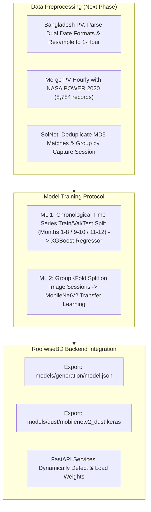

# RoofwiseBD — Machine Learning Feasibility & Data Quality Report

**Document Date**: November 16, 2026  
**Audited Datasets**: Bangladesh PV Monitoring (408k rows), SolNet (1,440 images), NASA POWER (61k hourly rows), Dhaka Rooftop (632k polygons).  
**Primary Objective**: Scientifically evaluate data quality, feature feasibility, data leakage risks, and model constraints before initiating Phase 3 ML model training.

---

## 1. ML 1 — Solar Generation Prediction (XGBoost)

### 1.1. Candidate Target Columns
The Bangladesh PV Monitoring dataset provides paired measurements for clean and dusty panels:
- `Clean_pmp`: Instantaneous Peak Maximum Power (Watts) generated by the clean module.
- `Clean_Panel_Point_Energy`: Point-wise energy generated (Wh) in the 30-second window.
- `Clean_Panel_Total_Energy`: Cumulative running energy (kWh).

**Recommended Target Variable**:  
- For instantaneous power modeling: **`Clean_pmp` (Watts)**.
- For hourly/daily energy modeling: **`Clean_Panel_Point_Energy` aggregated hourly to Wh/kWh**.
- *Target Selection Rule*: Never use cumulative total energy (`Clean_Panel_Total_Energy`) directly as a regression target without differencing, as non-stationary monotonic accumulation causes severe autogressive artifacts.

### 1.2. Candidate Input Feature Columns
From our empirical audit of all 25 columns, the valid predictive features are:
1. **Environmental / Meteorological Features**:
   - `Clean_Module_Irradiance` (or `Ideal_Irradiance` when deploying in forecast mode where sensor irradiance is simulated via clear-sky/NASA models)
   - `Clean Temperature` (or ambient temperature from NASA `T2M`)
   - `Humidity` (%)
   - `Wind Speed` (m/s)
   - `Air Pressure` (hPa)
2. **Temporal & Solar Geometry Features (Engineered)**:
   - `Tr(Hour)`: Decimal solar hour of the day.
   - Cyclic hour encoding: $\sin(2\pi \cdot \text{Hour}/24)$, $\cos(2\pi \cdot \text{Hour}/24)$.
   - Cyclic month encoding: $\sin(2\pi \cdot \text{Month}/12)$, $\cos(2\pi \cdot \text{Month}/12)$.
3. **Prohibited Features (Strict Target Leakage Prevention)**:
   - `Clean Current` ($I_{sc}$) and `Clean_VOC` ($V_{oc}$): In photovoltaic physics, $P = V \times I$. Using measured voltage and current to predict power $P_{mp}$ is a trivial algebraic identity, not a solar generation predictor. It causes total target leakage.
   - `Clean_Module_Cumulative_Energy` and `Clean_Panel_Total_Energy`: Directly derived from the historical target.
   - `Dusty_*` paired values: In production residential deployment, paired dusty probe measurements do not exist.

### 1.3. Alignment Feasibility: Bangladesh PV and NASA POWER
- **Sampling Difference**:
  - Bangladesh PV logs at **30-second intervals**.
  - NASA POWER logs at **hourly intervals (UTC)**.
- **Timestamp Standardization Protocol**:
  1. Parse the dual date formats in Bangladesh PV (`YYYY-MM-DD` vs `M/D/YYYY`).
  2. Parse `Time` (`H:MM:SS AM/PM`) and construct a unified UTC datetime index (Bangladesh Local Time BST = UTC + 6 hours).
  3. Aggregate the 30-second PV observations into 1-hour blocks (`resample('1H').mean()` for irradiance/temperatures, and `.sum()` for point-wise energy Wh).
  4. Merge with NASA POWER hourly rows for 2020 on `[YEAR, MO, DY, HR_UTC]`.
- **Sufficiency**: With 293 distinct days across 2020 and 8,784 matching NASA POWER rows, the dataset provides ample statistical power for training an XGBoost regressor.

### 1.4. Limitations of the 20W Experimental Test Bench
- **Scale Disparity**: The test bench utilizes a **20 Watt polycrystalline module** (peak output ~18.5W). Residential rooftop installations in Bangladesh utilize **550Wp–580Wp Monocrystalline PERC modules** configured in arrays of **2 kWp to 20 kWp**.
- **Model Role**: The XGBoost model trained on this dataset acts as a normalized baseline coefficient predictor ($\text{Power}/\text{Capacity}$) and relative derating predictor. Residential scaling requires multiplying normalized predictions by the residential system's actual DC rating ($kW_p$) and applying inverter efficiency curves.
- *Strict Transparency Directive*: RoofwiseBD must never present the 20W experimental model as an independently validated simulation for 100 kW commercial rooftops without explicit labeling of normalized scaling.

---

## 2. ML 2 — Solar Panel Dust Detection (MobileNetV2)

### 2.1. Dataset Suitability & Balance
- **Total Images Available**: **1,440 images**.
- **Clean Class**: 722 images (50.1%).
- **Dusty Class**: 718 images (49.9%).
- **Quality**: Zero corrupted files. High-resolution photos capturing authentic dust, fine sand, and atmospheric particulate deposits in Bangladesh.
- **Model Architecture**: MobileNetV2 with pre-trained ImageNet weights is exceptionally well-suited for this dataset size (1.4k images), offering lightweight deployment and rapid inference.

### 2.2. Critical Data Leakage Risks & Deduplication
Our audit revealed two significant duplicate patterns:
1. **83 Exact MD5 Duplicates** in the Dusty class and **9 Exact Duplicates** in the Clean class.
2. **600 Web-Compressed Images (`_11zon`)**: Exactly 300 clean and 300 dusty images are web-compressed variants of the high-resolution photos.
3. **Capture Session Clustering**: Photos were captured in rapid succession on specific dates (e.g. `20210916`, `20210917`, `20210919`, `20210922`, `20210923`).

### 2.3. Mandatory Data Split Strategy
- **Why Naive Random Splitting Fails**: A naive random 80/20 train/test split will place identical and near-identical photos of the same panel into both train and test partitions, resulting in severe data leakage and artificially inflated accuracy (>98%) that fails on real unseen panels.
- **Required Grouped Split Protocol**:
  1. Extract the base capture session identifier from the filename (e.g. date prefix `20210916_094041`).
  2. Perform **GroupKFold** or **GroupShuffleSplit** on capture sessions rather than individual files.
  3. Ensure that all photos from a given panel capture session belong entirely to either the train set or the test set.
  4. Deduplicate exact MD5 matches prior to training.

### 2.4. Independent Real-World Image Needs
- Because the SolNet dataset was captured on a localized set of panels over September 2021, collecting additional out-of-distribution panel photos across different seasons and camera angles in Bangladesh will be beneficial for post-university deployment.

---

## 3. Rooftop Spatial & GIS Analysis Feasibility

### 3.1. What Is Supported by the Dataset
- **Massive Spatial Coverage**: 632,745 building polygons across Greater Dhaka.
- **Available Parameters**:
  - `Surface_area`: Total footprint surface area ($m^2$).
  - `Potential_installable_area`: Usable area after setbacks ($m^2$, average ~52%).
  - `Peak_installable_capacity`: Sized DC capacity ($kW_p$).
  - `Energy_potential_per_year`: Annual solar yield (kWh/yr).
  - `Assumed_building_type`: 67.9% multi-family residential, 18.9% single-family residential.
  - `Estimated_tilt`: Average slope of roof surface.

### 3.2. What Cannot Be Inferred
- **Structural Civil Load-Bearing Safety**: The satellite polygons cannot determine concrete slab reinforcement, corrosion, or load-bearing limits.
- **Real-Time Obstacles**: Rooftop water tanks, mobile network towers, or temporary tin sheds added after 2019 are not captured in the 2019 WorldView-3 satellite imagery.
- **Installation Prices**: The `Unit_installation_price` column is 100% null (unverified). Market price models must continue to rely on RoofwiseBD's verified BDT/kWp market ranges.
- **No Pixel-Level Segmentation Masks**: The dataset does not provide raster image-to-mask pairs; U-Net satellite segmentation cannot be trained from this vector dataset alone.

---

## 4. NASA POWER Meteorological Scope

### 4.1. Available Parameters
- `ALLSKY_SFC_SW_DWN`: Downward shortwave solar irradiance ($Wh/m^2$).
- `T2M`: Ambient temperature at 2 meters (°C).
- `RH2M`: Relative humidity (%).
- `WS10M`: Wind speed ($m/s$).

### 4.2. Alignment with Bangladesh PV
- For the full 366 days of leap year 2020, NASA POWER provides **8,784 hourly readings with ZERO missing values**.
- These 4 parameters map directly to the PV monitoring dataset's environmental sensors:
  - NASA GHI $\leftrightarrow$ `Ideal_Irradiance` / `Clean_Module_Irradiance`
  - NASA `T2M` $\leftrightarrow$ `Clean Temperature`
  - NASA `RH2M` $\leftrightarrow$ `Humidity`
  - NASA `WS10M` $\leftrightarrow$ `Wind Speed`

### 4.3. Future Geographical Expansion
- To extend hourly ML generation forecasting beyond Dhaka to the remaining 7 divisions (Chattogram, Rajshahi, Khulna, Barishal, Sylhet, Rangpur, Mymensingh), additional NASA POWER coordinate extracts should be downloaded during Phase 3.

---

## 5. Phase 3 Machine Learning Roadmap

### Readiness Verdict
1. **ML 1 (Solar Generation Prediction)**: **READY FOR PREPROCESSING**. Sufficient data exists (408k rows across 2020 aligned with NASA POWER 2020 hourly baseline).
2. **ML 2 (Solar Dust Detection)**: **READY FOR PREPROCESSING**. Sufficient balanced data exists (1,440 images, 722 clean vs 718 dusty). Deduplication and session-grouped splitting are mandatory.
